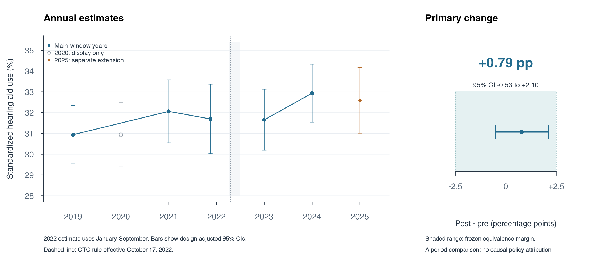

# OTC-HEAR-01 v1.0 终局报告

**终局：GO；A0、D、L0、L1、L2、L3、L4全部PASS。** GO表示本冻结合同的数据与校准链通过、预设分析全部完成；核心科学结论是**全国层面无有意义变化（等效成立）**。L4已经结束，不继续扩展窗口、改阈值或新增结果驱动子集。完成日期：2026-10-30（America/Los_Angeles）。

## 工程

合同原件与config在检索和结局计算前记SHA-256；最终再次核对，均未改动。合同SHA-256为`1e232c152a8e4446b7a833f9f6dd316e559fc2498c46ea06c4e5af6390832889`，配置SHA-256为`6c27c9d16b9674540dde5fc34da50fc2d7d90137e96906699175ed5592766ddf`。原件、冻结记录、脚本和日志均保留。

使用官方公开文件，R survey处理分层整群设计，mitools按Rubin规则合并10份收入插补。先建完整年度文件的调查设计，再进行域分析。PSTRAT/PPSU按NCHS公开文件的跨年规则保留，未人为加年份前缀。使用Taylor线性化SE及t区间。原始个体数据与含个体记录的缓存留在工作目录，交付包只包含聚合结果、公开文献证据、脚本与日志。

独立数值核查已通过：另以矩阵加权最小二乘复算主点估计；以逐PSU得分聚合手算有放回分层设计方差，主SE均为0.669229个百分点；Python/R主分析人数一致；手算Rubin总方差复核收入差中差SE为1.781058个百分点。见`logs/numeric_QA.csv`。这些是计算正确性核查。

同版本工程修复包括：官方Survey Description初始猜测文件名404后按目录改为srvydesc-508.pdf；PMC部分接口失败后使用公开全文备源；收入描述性水平的完整数据自由度改用实际设计自由度；图中文字重叠已修正。科学规则、窗口及结果分类未变。

## 数据

**A0 PASS（有检索覆盖限制）**：12条冻结检索式内未定位到EXACT/PARENT。Razura2025的原始PubMed摘要Methods是NHIS2007–2018，出版商全文未取得，保留摘要证据级别。[Razura原记录](https://pubmed.ncbi.nlm.nih.gov/40062586/)。Bessen2024的原文Methods和表格使用NHATS2011、2015、2022，Discussion明确不反映OTC使用。[Bessen原文](https://pmc.ncbi.nlm.nih.gov/articles/PMC11437379/)。MarkeTrak2025为线上研究面板、2024年10–11月采集，分类ADJACENT。[调查方法原文](https://pmc.ncbi.nlm.nih.gov/articles/PMC12638186/)。最近剩余增量是本合同的NHIS概率样本、固定H分母、等效界、阴性对照及MI收入分析。medRxiv/SSRN直接访问403，使用网页索引备源；未取得2024–2026完整会议摘要清单。预算内未检出重复不能证明绝对新颖。

**D PASS**：2019–2025核心助听器与听力困难题均存在、全体样本成人universe与实质编码一致。困难题的“即使使用助听器”是条件提示。2022有INTV_QRT，使用Q1–Q3，不触发剔除整年2022的回退。2025使用INTV_QRT2，Q4编码为9；不影响单列全年扩展。设计变量及50+均可识别。眼镜题、MA、VA/TRICARE及公共访谈方式字段均可用。

203条变量/年度审计记录含题目原文、universe、编码、原始有效N及页码。种族/族裔官方公开recode含插补，未插补N无法由该字段恢复，明确记UNVERIFIED并另报有效编码N；它不参与冻结主模型，未触发D停止门。2019–2020教育变量EDUC_A与2021起EDUCP_A的分类变化已记录。2024起代答指示采用PROXYFLAG_A。见`D/variable_audit.csv`与`D/doc_excerpts.md`。

各年度成人文件内HHX唯一；收入文件每名成人每个插补序号一行，10份完整、零失配，以同年HHX联结。访谈方式INTMODESA来自官方Paradata，1/2/3分别为全部/部分/无电话访问。所有进入各年度成人文件的记录均获得有效方式编码。没有跨年识别个人或联结外部数据。2020含官方2019再访部分，仅用于年度展示和合同字面的参考构成，不进入主比较。

**L0 PASS**：前期H(50+)未加权N=12,913（门槛6,000）；后期N=10,493（门槛5,000）。贫困比<200%的H每期在10份插补中分别计数，最小N为前期3,783、后期3,150（各门槛1,000）。仅收入直接报告者的对应人数也分别为2,900与2,367。未将10份插补当作10倍人数。主模型前期N=12,910、后期N=10,493，前期另外3名H因主结局/性别有效性不能进入模型；H人数门没有因此重新定义。

**L1 PASS**：6项点估计全部落入Data Brief414原文95%CI。下表原文数值来源为官方表格PDF第1页（困难）及第4页（助听器），45+总体与65+总体分行核验。[官方校准目标表](https://www.cdc.gov/nchs/data/databriefs/db414-tables-508.pdf)。

| 校准目标 | 原文百分比（95%CI） | 本流程百分比 | 判定 |
|---|---:|---:|---|
| 45+ 使用助听器 | 7.1（6.7–7.5） | 7.0533 | PASS |
| 65+ 使用助听器，总体 | 14.4（13.6–15.2） | 14.4268 | PASS |
| 65+ 使用助听器，男 | 19.2（17.8–20.6） | 19.1684 | PASS |
| 65+ 使用助听器，女 | 10.6（9.7–11.5） | 10.5655 | PASS |
| 18+ 一些听力困难 | 13.0（12.5–13.5） | 12.9909 | PASS |
| 18+ 很困难或无法听见 | 1.6（1.5–1.8） | 1.6217 | PASS |

## 科学结果

主分析为设计加权线性概率模型`aid ~ post + age×sex八格`。标准构成按合同字面为2019–2024完整年度合并H（50–64、65–74、75–84、85+ × 性别）；包含2020及2022Q4作为固定参考构成，不让它们进入前后主比较。前期覆盖2.75年，WTFA_A/2.75；后期2年，WTFA_A/2。具体解释在结局计算前写入实施记录。标准构成视为固定；该加法LPM的标准化差等于post系数。

**标准化前期使用率31.54%，后期32.33%；Δ=+0.79（-0.53 至 +2.10）个百分点。** 95%CI完全落在开放区间(−2.5,+2.5)，严格按冻结表判定：**全国层面无有意义变化（等效成立）**。该区间仍容许小幅变化；在同一模型和95%区间下，向上未排除的上界约为+2.10个百分点，向下约为−0.53个百分点。主估计文件：`L2/main_estimate.csv`；两期率及SE：`L2/period_rates.csv`。

逐年估计采用year×age-sex饱和模型与同一固定参考分布。各年独立标准化水平与主模型的合并期水平属于对应模型的估计，表中2020仅展示、2025仅扩展。每项率附设计校正SE和95%CI。

| 年份 | 标准化率%（95%CI） | 未加权N | 用途 |
|---|---:|---:|---|
| 2019 | 30.94（29.53–32.34） | 5,013 | main_window |
| 2020 | 30.93（29.39–32.47） | 4,966 | display_only |
| 2021 | 32.06（30.54–33.58） | 4,515 | main_window |
| 2022 前三季度 | 31.69（30.02–33.37） | 3,382 | pre_Q1_Q3 |
| 2023 | 31.65（30.19–33.12） | 4,895 | main_window |
| 2024 | 32.93（31.54–34.32） | 5,598 | main_window |
| 2025 | 32.59（31.01–34.17） | 4,356 | extension_only |

L3竞争解释如下，数值均为变化或变化差，单位为百分点，括号为95%CI。

| 分析 | 估计（95%CI） |
|---|---:|
| 眼镜/隐形眼镜，全体50+ | -0.21（-0.96 至 +0.55） |
| H患病率，全体50+ | +0.10（-0.67 至 +0.86） |
| 助听器使用，全体50+ | +0.23（-0.17 至 +0.63） |
| 加入访谈方式 | +0.77（-0.54 至 +2.09） |
| 后期观察值 − 前期趋势外推 | -0.13（-2.54 至 +2.29） |

眼镜Δ与助听器Δ方向相反，故未触发“同向且绝对值至少一半”的冻结降级条件。全体50+助听器口径与H内口径均为正，故未触发分母敏感标记。加入访谈方式后的结果基本相同。前期每年斜率为+0.31（-0.37 至 +0.99）个百分点/年，外推敏感性未显示明确的额外上升。未触发对照降级不建立政策因果识别。

L4次要结果如下。收入差中差是“低收入Δ−高收入Δ”，正值为预设的差距缩小方向；表中收入模型已按10份插补Rubin合并，使用年龄×性别调整。年龄梯度模型调整性别；频率变化调整年龄×性别。原始加权水平另外提供在L4中，避免与调整后的差值混用。

| 分析 | 估计（95%CI），百分点 |
|---|---:|
| 低收入 <200% 的变化 | +1.22（-1.50 至 +3.93） |
| 高收入 ≥400% 的变化 | +0.18（-1.87 至 +2.24） |
| 低收入变化 − 高收入变化（MI差中差） | +1.03（-2.47 至 +4.53） |
| 50–69岁变化 − 80+变化 | +0.40（-3.07 至 +3.88） |
| 使用者中一直使用的比例变化 | +0.91（-1.76 至 +3.58） |
| 2025扩展 − 冻结前期 | +1.06（-0.75 至 +2.87） |
| MA组变化（描述性） | +3.62（+0.93 至 +6.30） |
| 传统Medicare组变化（描述性） | -0.87（-3.25 至 +1.51） |
| 传统Medicare变化 − MA变化（描述性） | -4.49（-8.15 至 -0.82） |
| VA/TRICARE组变化（描述性） | -1.76（-5.70 至 +2.17） |

收入差中差CI跨0，不能确认差距缩小。年龄梯度CI较宽，不能确认年轻组变化更大。一直使用的变化未显示预设的下降。2025相对前期CI跨0，也未并入主估计。MA变化点估计大于传统Medicare，与合同预设的OTC梯度方向不同；其组间差为描述性、未经多重比较校正的估计，不能据此归因为MA福利扩张。VA/TRICARE组CI较宽，不能断言变化为0。全部次要CI均为逐项95%CI，不用于替代主结论或筛选有利子集。

测量/构念上限：HEARAID_A没有区分OTC设备、处方设备、购买时间或新用户；H并集保障使用者被包含，但不是固定个体队列。FDA在2024-09-12已授权兼容AirPods的助听软件，因此合同的“2023–2024纯OTC设备时期”标签不能严格成立。[FDA原公告](https://www.fda.gov/news-events/press-announcements/fda-authorizes-first-over-counter-hearing-aid-software)。窗口保持冻结，结论限于总体助听器使用的全国政策时期变化；不推断OTC设备本身的有效性或政策因果效应。年度权重校准和回应结构也可能影响比较，详见D官方文档摘录。

## 是否继续投入

**终局GO，L4后停止新增分析。** 本题已具备校准通过、可复算的全国时期变化估计，可以围绕预设等效结果整理克制的描述性报告；若后续授权成稿，保留A0有限检索的约束和上述测量边界。当前合同不提供政策因果识别，不支持用次要保险结果挽救主张，也不自动升级v1.1。

失败分层：工程＝通过；数据可执行性＝通过；测量/构念＝总体使用可测、设备类型与政策归因受限；科学结果＝冻结等效成立；增量＝A0预算内未触发STOP_DUP，绝对新颖性未获证明。

## 与合同的偏离

1. 检索覆盖限制：medRxiv/SSRN直接访问失败，已用公开索引备源；未完成完整会议摘要清单。A0的PASS是预算内未定位EXACT/PARENT，未将平台访问失败表述为文献不存在。
2. 原交接PMC引文对应错误：PMC12638189作者为Jilla/Jorgensen，Picou/Huang文章为PMC12638185（DOI10.1055/s-0045-1812034）；只核正查重记录，不改冻结合同。
3. 对“纯OTC设备时期”作构念限定，未改2023–2024主窗口、2025扩展、年龄、人群、±2.5阈值、对照或停止规则。
4. 主分析权重、固定参考构成、L0按插补逐份计数等合同未完全细化的工程选择，已在结局计算前记录；保险字段的具体操作编码在读取对应组别结果前明确。随后只修编码/绘图/自由度工程问题，未修改科学阈值。种族/族裔未插补N不可恢复，按UNVERIFIED公开记录，未补造数据。

最终状态见`status.json`，原始冻结哈希见`SHA256SUMS`，全包文件哈希见`ARTIFACT_SHA256SUMS`。没有使用v1.1。
